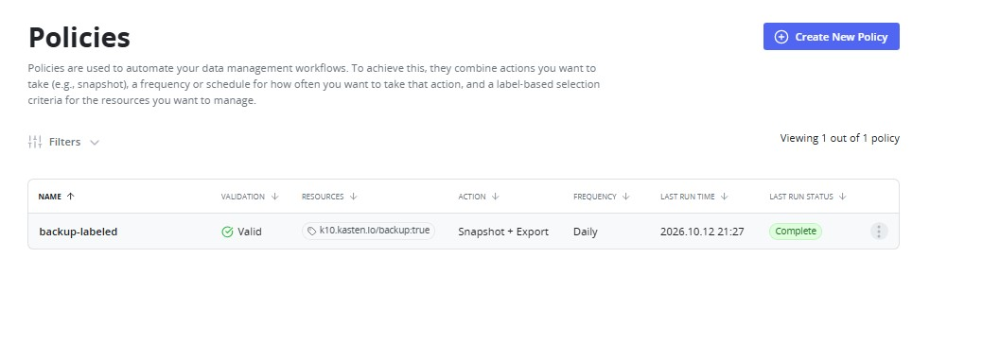
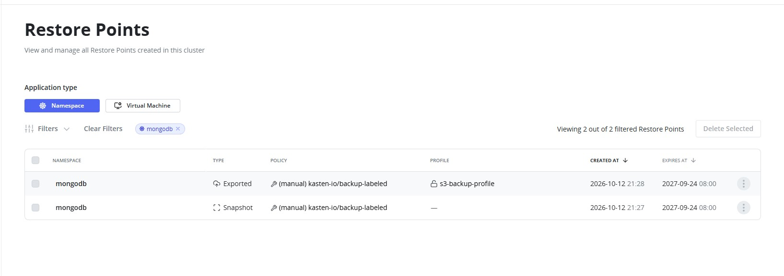
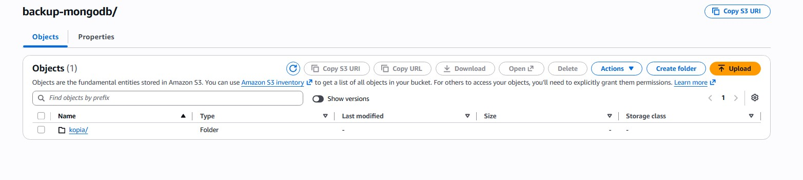
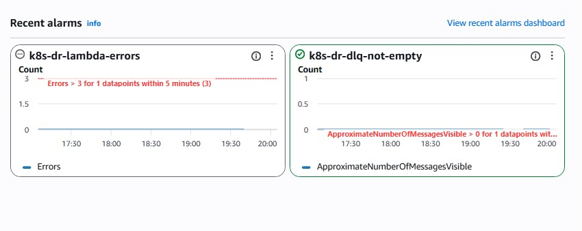
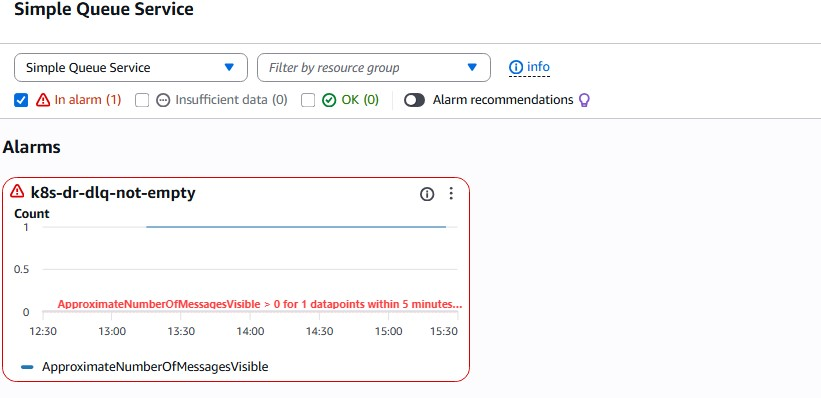
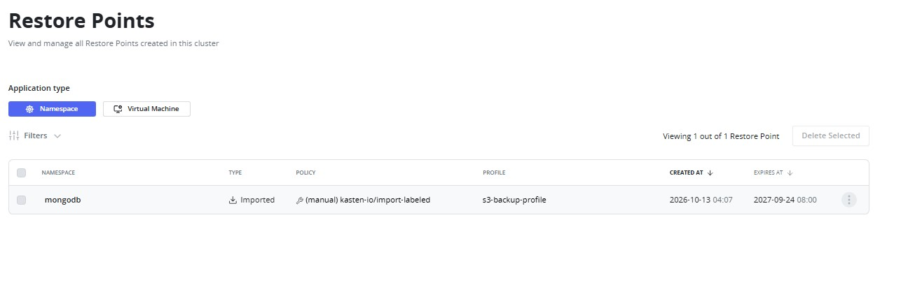
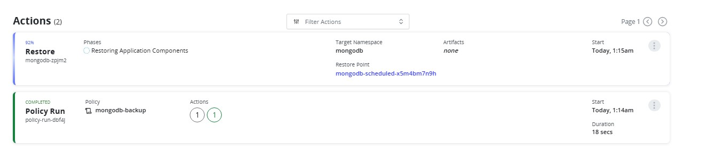
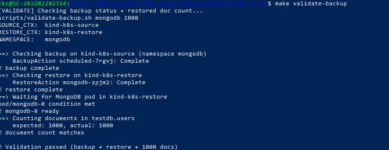
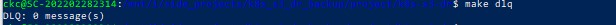

# k8s-s3-dr

Cross-cluster disaster recovery lab: two Kind clusters running MongoDB, backed up by Kasten K10 to AWS S3, validated end to end.


## What it does

- Two Kind clusters: one backs up, one restores
- MongoDB StatefulSet as the test workload
- Kasten K10 exports backups to an S3 bucket
- Restore cluster imports the backup and restores MongoDB
- **Two independent validation layers:**
  - **AWS-side (automatic):** S3 `ObjectCreated` → SQS → Lambda checks each backup object's size; failures retry 3× and land in a DLQ
  - **Cluster-side (manual):** Kasten CR statuses + MongoDB document count
- **Two workflows, same infrastructure:**
  - **Scripted** (`make e2e` → `make dr`): fully automated DR cycle
  - **UI-driven** (`make infra`): no policies pre-created; backup, export, import, and restore are performed in the Kasten UI

## Architecture

```
┌────────────────────────┐         ┌────────────────────────┐
│  Cluster A (source)    │         │  Cluster B (restore)   │
│  Kind: k8s-source      │         │  Kind: k8s-restore     │
│                        │         │                        │
│  MongoDB StatefulSet   │         │  MongoDB StatefulSet   │
│  Kasten K10            │         │  Kasten K10            │
│  CSI hostpath driver   │         │  CSI hostpath driver   │
│  VolumeSnapshotClass   │         │  VolumeSnapshotClass   │
└───────────┬────────────┘         └───────────▲────────────┘
            │ backup                           │ restore
            ▼                                  │
      ┌──────────────────────────────────────────┐
      │   S3 bucket (k10/...)                    │
      └───────────────┬──────────────────────────┘
                      │ ObjectCreated
                      ▼
              ┌───────────────┐     ┌────────────────┐
              │  SQS queue    │────▶│  Lambda        │
              │               │     │  (validator)   │
              └───────┬───────┘     └────────────────┘
                      │ 3 failures
                      ▼
              ┌───────────────┐
              │  DLQ (14d)    │
              └───────────────┘
```

A separate S3 bucket holds Terraform's remote state (bootstrapped once via `make bootstrap-backend`).

## Screenshots

### Source cluster — backup policy and RestorePoint



*`backup-labeled` policy with snapshot + export enabled, pointing at `s3-backup-profile`.*



*A completed backup appears as a RestorePoint. The export to S3 makes it visible to the restore cluster.*

### AWS pipeline — S3, SQS, CloudWatch



*S3 bucket showing `k10/<cluster-id>/migration/backup-labeled/` — the Kopia repository structure Kasten writes.*



*Both alarms in OK state — nothing failing, DLQ empty.*



*`k8s-dr-dlq-not-empty` fires ~90s after a bad object triggers 3 Lambda failures.*

### Restore cluster — import and restore



*The imported `mongodb` app — the RestorePoint is now visible on the restore cluster.*



*RestoreAction phases running. "All phases completed successfully" confirms the data was injected.*

### Verification



*The restored MongoDB has exactly 1000 documents — ground-truth proof the DR worked.*



*`make dlq` showing the AWS pipeline health after a successful DR cycle.*

## Choose your workflow

Both workflows provision the **same infrastructure** (clusters, AWS, CSI, Kasten, MongoDB). They differ in whether the DR policies are created for you.

| | Scripted (`make e2e`) | UI-driven (`make infra`) |
|---|---|---|
| Setup command | `make e2e` | `make infra` |
| Policies | Created automatically | You create them in Kasten UI |
| Backup / export | `make dr` | UI: run policy once |
| Import / restore | `make dr` | UI: import, then restore |
| Best for | CI, reproducibility | Demos, learning Kasten |

## Environment support

Runs on any OS that can run Docker + Kind. **WSL is not required.**

| Environment | Status | Notes |
|---|---|---|
| **Native Linux** | ✅ Recommended | Simplest — no virtualization layer |
| **WSL2 on Windows** | ✅ Supported |
| **macOS** | ✅ Supported | 
| **Windows (native)** | ⚠️ Not recommended | 

If you're on Windows, use **WSL2**. On macOS or Linux, use your native shell.

## Prerequisites

### Docker (choose one)

| Option | Best for | Cost |
|---|---|---|
| **Docker Engine** (`apt` / `dnf`) | Native Linux | Free |
| **Docker Desktop** | Windows / macOS / WSL2 | Free personal; paid for larger companies |
| **Rancher Desktop** | Windows / macOS | Free, open source |
| **Colima** | macOS | Free, lighter than Docker Desktop |

**Native Linux:**

```bash
sudo apt update
sudo apt install -y docker.io docker-compose-plugin make jq gettext
sudo usermod -aG docker "$USER"
# log out and back in
docker run --rm hello-world
```

**WSL2:** either install Docker Engine inside WSL (same as above), or use Docker Desktop with WSL integration enabled.

**macOS:**

```bash
brew install colima docker make jq gettext
colima start --cpu 4 --memory 12
docker run --rm hello-world
```

### System resources

| Resource | Minimum | Recommended |
|---|---|---|
| RAM for Docker | 8 GB | 12–16 GB |
| CPUs for Docker | 2 | 4+ |
| Disk | 20 GB | 40 GB |

**WSL2** — cap memory in `C:\Users\<you>\.wslconfig`:

```ini
[wsl2]
memory=12GB
processors=6
swap=2GB
```

Then `wsl --shutdown` from PowerShell.

**macOS with Colima** — pass `--cpu 4 --memory 12` at startup.

### AWS account

You need:

- **IAM Identity Center (SSO)** configured — so you can `aws configure sso`
- Permission to create: S3 buckets, SQS queues, Lambda functions, IAM roles, IAM users, CloudWatch alarms

Free-tier usage is fine — pennies per month for this lab.

### CLI tools

| Tool | Version | Install |
|---|---|---|
| `kind` | v0.24+ | https://kind.sigs.k8s.io/docs/user/quick-start/#installation |
| `kubectl` | v1.28+ | https://kubernetes.io/docs/tasks/tools/ |
| `helm` | v3.12+ | https://helm.sh/docs/intro/install/ |
| `terraform` | v1.5+ | https://developer.hashicorp.com/terraform/install |
| `aws` (CLI v2) | v2.x | https://docs.aws.amazon.com/cli/latest/userguide/getting-started-install.html |
| `jq` | any | `apt install jq` / `brew install jq` |
| `envsubst` | any | part of `gettext` |
| `make` | any | `apt install make` / `brew install make` |

Quick check:

```bash
for t in kind kubectl helm terraform aws jq envsubst make docker; do
  command -v "$t" >/dev/null && echo "OK: $t" || echo "MISSING: $t"
done
```

## Setup

### 1. Clone the repo

```bash
git clone https://github.com/ckc9014/k8s-s3-dr.git
cd k8s-s3-dr
```

### 2. Configure AWS SSO

```bash
aws configure sso
```

| Prompt | What to enter |
|---|---|
| SSO session name | `my-sso` |
| SSO start URL | Your org's portal URL |
| SSO region | Where IAM Identity Center is configured |
| SSO registration scopes | Press Enter |
| CLI default client Region | `eu-west-1` |
| CLI default output format | `json` |
| CLI profile name | `k8s-dr-eu` |

Verify:

```bash
aws configure list-profiles
aws sso login --profile k8s-dr-eu
aws sts get-caller-identity --profile k8s-dr-eu
```

### 3. Create `.env` from the template

```bash
cp .env.example .env
```

Required variables:

```bash
AWS_PROFILE=k8s-dr-eu
AWS_REGION=eu-west-1

# Filled in by `make iam-setup`
K10_AWS_ACCESS_KEY_ID=
K10_AWS_SECRET_ACCESS_KEY=
```

> **Do not add `AWS_ACCESS_KEY_ID` / `AWS_SECRET_ACCESS_KEY` here.** They override your SSO profile and cause confusing `InvalidAccessKeyId` errors.

### 4. Bootstrap the Terraform state bucket (once)

```bash
make bootstrap-backend
```

Creates an S3 bucket for Terraform's remote state, so your `.tfstate` survives laptop failures. Idempotent — safe to re-run. If the local state file is lost, the target auto-imports the existing bucket.

### 5. Provision infrastructure

Pick one:

```bash
# Scripted workflow — infra + policies
make e2e

# UI-driven workflow — infra only, no policies
make infra
```

Both create: Kind clusters, AWS resources (S3, SQS, Lambda, IAM, CloudWatch alarms), CSI snapshot stack, Kasten K10, and MongoDB.

### 6. Create the Kasten IAM user

```bash
make iam-setup
```

Runs `scripts/setup-iam-user.sh`, which creates IAM user `kasten-s3-backup`, attaches a bucket-scoped S3 policy, mints an access key, and writes `K10_AWS_ACCESS_KEY_ID` / `K10_AWS_SECRET_ACCESS_KEY` into `.env`.

Verify:

```bash
grep -E '^K10_AWS_' .env | sed 's/=.*/=<set>/'
```

## Running the DR cycle

### Scripted workflow

```bash
make seed-mongo          # drop + insert 1000 docs on source
make backup              # snapshot + export to S3 (waits for both)
make import-restore-points   # import into restore cluster
make restore             # restore MongoDB
make validate-backup     # assert 1000 docs
```

Or the whole thing:

```bash
make dr
```

`make dr` is **idempotent** — re-run it as many times as you want. Each run creates a new backup and imports it. No `reset-dr` needed for normal re-runs.

### UI-driven workflow

**1. Port-forward the source cluster's Kasten UI**

```bash
kubectl --context kind-k8s-source -n kasten-io port-forward svc/gateway 8080:80
```

Generate a token (new terminal):

```bash
kubectl --context kind-k8s-source -n kasten-io create serviceaccount k10-admin 2>/dev/null || true
kubectl --context kind-k8s-source create clusterrolebinding k10-admin-binding \
  --clusterrole=cluster-admin \
  --serviceaccount=kasten-io:k10-admin 2>/dev/null || true
kubectl --context kind-k8s-source -n kasten-io create token k10-admin --duration=24h
```

Open `http://127.0.0.1:8080/k10/#/` and paste the token.

**2. Create a backup policy**

- Applications → `mongodb` → Create Policy
- Name: `backup-labeled`, Frequency: `@daily` (or `@hourly` / `@weekly`)
- Add Action → Backup
- Enable "Backups via Snapshot Exports" → select `s3-backup-profile`
- Save → Run once

> **Note on frequency:** `@onDemand` policies never show as *Compliant* because Kasten has no expectation to compare against. Use a scheduled frequency for the compliance dashboard to be meaningful.

**3. Port-forward the restore cluster's Kasten UI**

```bash
kubectl --context kind-k8s-restore -n kasten-io port-forward svc/gateway 8081:80
```

Generate a token (new terminal):

```bash
kubectl --context kind-k8s-restore -n kasten-io create serviceaccount k10-admin 2>/dev/null || true
kubectl --context kind-k8s-restore create clusterrolebinding k10-admin-binding \
  --clusterrole=cluster-admin \
  --serviceaccount=kasten-io:k10-admin 2>/dev/null || true
kubectl --context kind-k8s-restore -n kasten-io create token k10-admin --duration=24h
```

Open `http://127.0.0.1:8081/k10/#/` and paste the token.

**4. Create an import policy**

- Policies → Create Policy
- Name: `import-labeled`, Action: Import
- Paste the migration token from the source policy:

  ```bash
  kubectl --context kind-k8s-source -n kasten-io get policy backup-labeled \
    -o jsonpath='{.spec.actions[?(@.action=="export")].exportParameters.receiveString}'
  ```

- Save → Run once

**5. Restore**

- Applications → filter by **Imported** → `mongodb` → Restore
- Choose the RestorePoint → confirm
- Watch phases complete

**6. Verify**

```bash
kubectl --context kind-k8s-restore -n mongodb get pods
kubectl --context kind-k8s-restore -n mongodb exec mongodb-0 -- \
  mongosh --quiet -u root -p labpassword --authenticationDatabase admin \
  --eval 'db.getSiblingDB("testdb").users.countDocuments()'
# → 1000
```

## AWS pipeline observability

Two CloudWatch alarms, both created by Terraform:

| Alarm | Watches | Fires when |
|---|---|---|
| `k8s-dr-lambda-errors` | Lambda `Errors` metric | >3 errors in 5 min (early warning) |
| `k8s-dr-dlq-not-empty` | DLQ `ApproximateNumberOfMessagesVisible` | >0 (after 3 retries fail) |

Test the pipeline without Kasten:

```bash
make test-lambda        # upload 10 KB → passes, no DLQ
make test-lambda-fail   # upload 2 bytes → fails 3× → DLQ entry

# Wait ~2 minutes (3 retries × 60s visibility timeout)
make dlq                # → "DLQ: 1 message(s)"
```

Watch the Lambda live:

```bash
aws logs tail /aws/lambda/$(jq -r '.lambda_function_name.value' .tf-output.json) \
  --follow --profile k8s-dr-eu --region eu-west-1
```

Check alarm states:

```bash
aws cloudwatch describe-alarms \
  --alarm-names k8s-dr-lambda-errors k8s-dr-dlq-not-empty \
  --profile k8s-dr-eu --region eu-west-1 \
  | jq -r '.MetricAlarms[] | "\(.AlarmName): \(.StateValue)"'
```

### What the Lambda validates

| Input | Behavior |
|---|---|
| Real backup data (≥ 64 bytes) | `OK` |
| Kasten metadata (`kopia.*`, `xn0_*`, `_log_*`) | `SKIP` |
| S3 TestEvent (AWS verification) | `SKIP` |
| Empty / truncated object | `FAIL` → 3 retries → DLQ |
| Malformed event | `ERROR` → DLQ |

The Lambda does **not** open the backup or verify content — it's a size-only smoke detector. Content correctness is validated at restore time by counting MongoDB documents.

## Day-to-day commands

```bash
make help              # list all targets
make dlq               # show DLQ depth only
make list              # list Kind clusters
make down              # delete both Kind clusters (keeps AWS)
make clean             # delete clusters + local artifacts
```

Each session, refresh SSO (tokens expire after ~8h):

```bash
aws sso login --profile k8s-dr-eu
```

## Tear down

```bash
make down              # delete Kind clusters
make destroy           # destroy AWS resources (S3, SQS, Lambda, IAM, alarms)
make destroy-backend   # destroy the Terraform state bucket (type "yes")
```

Or all at once:

```bash
make teardown          # down → destroy → destroy-backend
```

The S3 backup bucket has `force_destroy = true`, so `terraform destroy` empties it before deleting — even when full of Kasten data.

## Repository layout

```
k8s-s3-dr/
├── Makefile                          # Single entry point
├── README.md
├── .env.example
├── .gitignore
├── .gitattributes
│
├── docs/
│   └── images/                       # Screenshots referenced by README
│
├── scripts/
│   ├── bootstrap-clusters.sh         # CSI snapshot stack on both clusters
│   ├── deploy-kasten.sh              # K10 + Location Profile (no policies)
│   ├── deploy-policies.sh            # Backup + import policies
│   ├── setup-iam-user.sh             # Kasten IAM user → .env
│   ├── refresh-import-token.sh       # Migration token handoff
│   ├── link-restorepoints.sh         # RestorePointContent → RestorePoint
│   ├── restore.sh                    # Trigger RestoreAction
│   └── validate-backup.sh            # CR statuses + MongoDB doc count
│
├── terraform/
│   ├── bootstrap/                    # State bucket module (local state)
│   │   ├── main.tf
│   │   ├── variables.tf
│   │   ├── outputs.tf
│   │   └── .terraform.lock.hcl       # committed
│   │
│   ├── main.tf                       # Provider config + default tags
│   ├── backend.tf                    # S3 remote backend declaration
│   ├── variables.tf
│   ├── outputs.tf
│   ├── s3.tf                         # Backup bucket (force_destroy=true)
│   ├── s3-notification.tf            # ObjectCreated → SQS
│   ├── sqs.tf                        # Main queue + DLQ + redrive policy
│   ├── lambda.tf                     # Validator function + IAM role
│   ├── cloudwatch.tf                 # Two alarms
│   └── .terraform.lock.hcl           # committed
│
├── lambda/
│   └── handler.py                    # S3-event size validator
│
└── manifests/
    ├── kind-cluster-config.yaml      # Shared Kind config for both clusters
    │
    ├── mongodb/
    │   ├── statefulset.yaml
    │   ├── service.yaml
    │   └── secret.yaml
    │
    └── kasten/
        ├── k10-values.yaml           # Helm values for K10 install
        ├── s3-secret.yaml            # S3 credentials (rendered by envsubst)
        ├── location-profile.yaml     # Kasten Location Profile
        ├── backup-policy.yaml        # Source cluster backup policy
        ├── import-policy.yaml        # Restore cluster import policy
        ├── run-action.yaml           # Trigger backup policy
        ├── restore-point.yaml        # restore-point of the policy
        ├── namespace.yaml
        └── import-run-action.yaml    # Trigger import policy
```

## How validation works

| Layer | Where | Checks | Trigger |
|---|---|---|---|
| **AWS-side** | Lambda in AWS | S3 object exists, size ≥ `MIN_SIZE_BYTES` (64) | Automatic on `ObjectCreated` |
| **Cluster-side** | `scripts/validate-backup.sh` | Kasten CR status + MongoDB doc count | Manual via `make validate-backup` |

The Lambda can't reach the Kind cluster (no network path from AWS to your laptop), so the two layers run independently. Together they cover:

- Backup reached S3 ✅
- Backup isn't empty ✅
- Kasten thinks backup + restore succeeded ✅
- The restored data has the expected number of documents ✅

## Troubleshooting

| Symptom | Cause | Fix |
|---|---|---|
| `InvalidAccessKeyId` from AWS CLI | Static keys in `.env` override SSO | Remove `AWS_ACCESS_KEY_ID` / `AWS_SECRET_ACCESS_KEY` from `.env` |
| `make dr` times out at import | Export hadn't finished before import fired | Ensure `backup` target waits for ExportAction (see Makefile) |
| `No kopia manifests found` | Token points at a repository with no data | `make reset-dr && make dr` (or teardown + rebuild) |
| DLQ fills after every backup | Lambda flagged Kasten metadata as failure | Confirm `MIN_SIZE_BYTES=64` and metadata skip are deployed |
| `Error: CRD not found` during deploy | Kasten CRDs not yet registered | The script waits 15 min — re-run if cluster is very slow |
| Policy shows **Unmanaged** despite covering the app | Policy uses `@onDemand` | Change to `@daily` / `@hourly` for compliance to compute |
| `make destroy` fails on non-empty bucket | `force_destroy = false` in state | Run `make terraform-apply` to sync |
| Bucket already exists error on bootstrap | Local bootstrap state lost | Re-run `make bootstrap-backend` — it auto-imports |